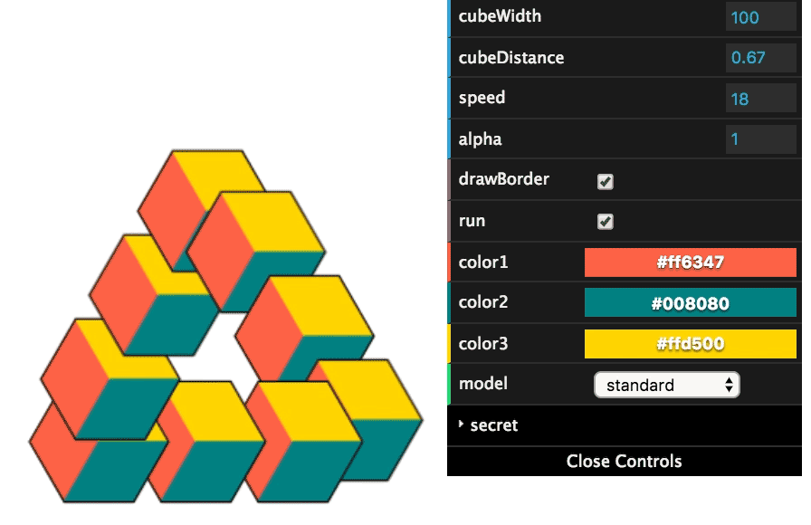

## Demo
The deployed version is on [impossible-object.pfp.workers.dev](https://impossible-object.pfp.workers.dev).

The project was created as a solution for a JavaScript meet-up challenge: [JSMD challenge #0.](https://github.com/JSMD/challenges/blob/master/challenge%20%230/README.md)

### Controls
Most of the controls are quite self-explanatory.

The `secret` toolbar contains some settings which are more advanced and are not really needed but were left as a way for the user to experiment and understand how to the application works.

The `compositeMode` corresponds with composite mode of the JS Canvas. The 3 uppermost settings are the only ones that make sense to use yet all the other ones were also added.

The `renderMethod` will provides 2 methods of drawing the cubes.

The `full` option will use another canvas with the same size as the visible one to render partial cubes.

The `single` option will use just a small canvas to draw the partial cube and thus should be smaller yet it may create small sub-pixel artifacts (which are really hard to observe).

Both methods were added because I tried to decide which one was better. The `full` method needs a bigger canvas and is a little bit slower yet it seems to have a better visual result.

## Building
To create the project the `webpack` or `webpack --watch` commands can be used which will create a `/dist` folder.

To serve this folder, `webpack-dev-server` or `http-server` or any other server can be used.

## Deployment

GitHub Actions builds with npm and deploys with Alchemy. Pushes to `master`
deploy the production Worker at https://impossible-object.pfp.workers.dev.
Each pull request creates an `impossible-object-pr-<number>` Worker. Closing
the pull request removes that preview.

Workers Builds is disabled. The production Worker is retained during stack
removal, and each production deployment first checks the plan for resource
creation, deletion, or replacement.
